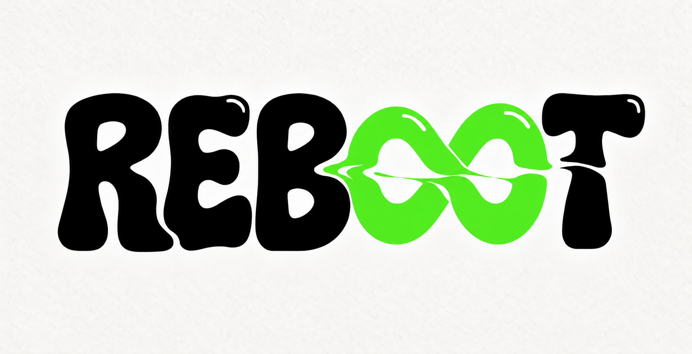

# REBOOT US Marketing Dashboard

> 한국 숙취해소제 **'알디콤'**의 미국 시장 마케팅을 위한 **마케터 업무용 Flask 대시보드**
> 미국 트렌드를 분석하고, FDA 규제를 지키면서, 채널별 콘텐츠를 빠르게 만드는 것을 목표로 합니다.

---

## 목차

1. [프로젝트 개요](#1-프로젝트-개요)
2. [사용자 페르소나](#2-사용자-페르소나)
3. [해결하려는 문제](#3-해결하려는-문제)
4. [서비스 설계 원칙](#4-서비스-설계-원칙)
5. [메뉴 구성](#5-메뉴-구성)
6. [폴더 구조](#6-폴더-구조)
7. [설치 및 실행](#7-설치-및-실행)
8. [환경 변수](#8-환경-변수)
9. [배포](#9-배포)
10. [개발 우선순위 로드맵](#10-개발-우선순위-로드맵)
11. [팀 및 역할](#11-팀-및-역할)
12. [규제·데이터 사용 유의사항](#12-규제데이터-사용-유의사항)
13. [협업 규칙](#13-협업-규칙)

---

## 1. 프로젝트 개요

| 항목 | 내용 |
|---|---|
| 회사 | **알디콤 (ALDICOM)** — 한국 숙취해소제 기업 |
| 신규 라인 | **Reboot** — 미국 시장을 위한 새로운 라인 |
| 출시 목적 | 미국 소비자에게 낯선 카테고리인 숙취해소제를 더 친숙하게 소개하기 위함 |
| 목표 시장 | 미국 |
| 판매 채널 | Amazon(일반 미국 소비자), Weee · Yamibuy(아시아계), TikTok · Instagram(2030 숏폼) |
| 서비스 사용자 | 미국 채널 담당 마케터 (1인) |
| 서비스 형태 | 사내 업무용 웹 대시보드 (Flask) |

### 한 줄 목표

> **"효능을 말할 수 없는 상태에서, 낯선 카테고리를, 여러 채널에, 정확한 타이밍에 알린다."**
> → 규제를 지키면서, 채널별로, 시즌에 맞춰 **빠르게 콘텐츠를 만드는 방법**을 제공한다.

### 브랜드



| 항목 | 내용 |
|---|---|
| 라인명 | **Reboot** |
| 색 | 검정 & 네온 |
| 슬로건 | *"Restart Your Day"* |
| 캐릭터 | 리부부 |
| CM송 | 니온 앤 리부 |

### 제품 라인업

> 기준: **제품 사양서 · 성분표 (2026-10-25, 내부 검토용)**. 출처는 제품 최종 정보(2026-10-25 팀 확정) · 브랜드 가이드 v1.1 · 컴플라이언스 원료 검토(2026-10-25) · Balance 당류 측정 결과(PM 확인 2026-10-25)입니다. 법률 자문이 아닙니다.
> 대시보드의 제품 정보 초기값은 [`data/products.json`](data/products.json)이고, 실행 후에는 설정 › 제품 정보에서 고칩니다.

| 항목 | Jelly Original | Jelly Balance | Drink Original | Drink Balance |
|---|---|---|---|---|
| 제품 코드 | RBT-J-01 | RBT-J-02 | RBT-D-01 | RBT-D-02 |
| 내부 제품명 | Reboot Jelly Original | Reboot Jelly Balance | Reboot Drink Original | Reboot Drink Balance |
| 한글 이름 | Reboot 젤리 | Reboot 제로슈가 젤리 | Reboot 음료 | Reboot 제로슈가 음료 |
| 분류 | 일반식품 (건강기능식품 아님) | 일반식품 | 일반식품 | 일반식품 |
| 형태 | 개별 포장된 모양 젤리 (카우보이 부츠 · 모자 · 올가미) · 진한 색 | Original과 같은 모양 · 연한 색 | 비탄산 음료 · 소형 유리병 | 비탄산 음료 · 소형 유리병 |
| 맛 | Lime · Lemon · Cherry | Cherry · Lime · Lemon | Lemon · Cherry · Lime | Lemon · Lime · Cherry |
| 포장 | 한 봉지 (개별 포장 젤리 10개) | 한 봉지 (개별 포장 젤리 10개) | 낱개 · 3병 박스 | 낱개 · 3병 박스 |
| 용량 · 중량 | 미정 (젤리 1개 · 1봉지 중량) | 미정 (젤리 1개 · 1봉지 중량) | 100 mL (병 높이 108 mm) | 100 mL (병 높이 108 mm) |
| 가격 (USD) | $17.99 (1개당 $1.80) | $19.99 (1개당 $2.00) | 낱개 $4.99 · 3병 $12.99 | 낱개 $5.49 · 3병 $14.49 |
| Zero Sugar 표시 | 쓰지 않음 | 사용 (조건 아래) | 쓰지 않음 | 사용 (조건 아래) |

젤리 모양 · 색: 체리 = 카우보이 모자(분홍) · 레몬 = 올가미(노랑) · 라임 = 부츠(연두). 리볼버 모양은 제품 구성이 아닙니다.

#### 당류 · 열량

| 제품 | 당류 · 1회 섭취 기준량(RACC) | 당류 · 라벨 1회 제공량 | 열량 · 1회 제공량 | 상태 |
|---|---|---|---|---|
| Jelly Original | 미정 | 미정 | 미정 | 측정 전 · 참고 이미지 수치는 쓰지 않음 |
| Jelly Balance | 0.5 g 미만 | 0.5 g 미만 | 40 kcal 이하 (목표) | 당류: 측정 · PM 확인 (2026-10-25) · 열량: 설계 목표 |
| Drink Original | 미정 | 미정 | 미정 | 측정 전 · 참고 이미지 수치는 쓰지 않음 |
| Drink Balance | 0.5 g 미만 | 0.5 g 미만 | 40 kcal 이하 (목표) | 당류: 측정 · PM 확인 (2026-10-25) · 열량: 설계 목표 |

**Balance 'Zero Sugar' 표시 조건** (21 CFR 101.60(c)(1))

| 조건 | 현재 상태 |
|---|---|
| 1회 섭취 기준량과 라벨 1회 제공량 모두 당류 0.5 g 미만 | 충족 — 측정 · PM 확인 (2026-10-25) · 시험 성적서 보관 |
| 당이나 당이 든 원료를 넣지 않음 (넣었다면 원재료 표시에 별표와 'adds a trivial amount of sugar') | 감미료 배합 확정 때 확인 |
| 저칼로리가 아니면 'Not a low calorie food' 같은 문구를 Zero Sugar 표시마다 함께 적음 | 문구 유지 — 열량은 목표(40 kcal 이하)라 측정 확인 전까지 표시 |

- FDA 저칼로리(Low Calorie) 기준은 라벨 1회 제공량이 아니라 **1회 섭취 기준량(RACC)**으로 판단합니다.
  - 음료 RACC는 360 mL(12 fl oz)입니다. 100 mL 병이 40 kcal이면 360 mL 기준 약 144 kcal라 저칼로리가 아닙니다 (저칼로리가 되려면 100 mL당 약 11 kcal 이하).
  - 젤리는 RACC 30 g 이하 식품이면 RACC당 40 kcal 이하이면서 50 g당 40 kcal 이하여야 합니다. 젤리의 RACC 분류와 1회 제공량은 확인 중입니다.
- 측정 전에는 'Low Calorie'라고 광고하거나 라벨에 쓰지 않습니다. 알룰로스(Balance 감미료 후보)는 FDA 지침상 총당류 · 첨가당에 넣지 않고 1 g당 0.4 kcal로 계산합니다.
- RACC 분류와 저칼로리 판단은 21 CFR 101.12 · 101.60(b)로 최종 확인합니다.

#### 성분

**확정 원료 (4종 공통)**

| 원료 | 영문 표시명 | 함량 | 확인할 것 |
|---|---|---|---|
| 헛개나무 열매 추출물 | Hovenia dulcis fruit extract | 미제공 | 미국 일반식품 원료 근거(GRAS) 확인 전 · FDA 공개 GRAS 통지 0건 · 알디콤 근거 문서 필요 |
| 락토바실러스 퍼멘텀 (유산균) | Lactobacillus fermentum | 미제공 | 균주명 · 열처리균 여부 (구미 가열 · 산성 음료에서 생존 어려움) · 'probiotic' 같은 기능 표현은 쓰지 않음 |
| A-HAT (알디콤 조성물) | 라벨에는 실제 원료명으로 | 미제공 | 지구자 · 헛개나무 추출물 + L. fermentum · 'A-HAT' 이름 하나로 성분 표시를 대신할 수 없음 · 'patented'는 광고에 쓰지 않음 |

**기본 배합 후보** (확정 배합 아님 · 실제 배합 · 순서 · 함량은 알디콤 배합표로 확정 · 원재료는 많이 들어간 순서대로 모두 적음, 21 CFR 101.4)

| 구분 | 젤리 (구미형) | 음료 (비탄산) |
|---|---|---|
| 당 원료 · Original만 | 설탕(사탕수수당) · 타피오카 시럽 · 물엿 | 과당 · 설탕 |
| 감미료 · Balance만 | 알룰로스 · 스테비아(고순도 스테비올 배당체, Reb M) · 나한과 · 수크랄로스 중 선택 | 수크랄로스 등 승인 감미료 (알룰로스 · 스테비아 · 나한과 후보) |
| 몸체 · 겔화 | 펙틴(곤약 대신) · 수용성 식이섬유 · 정제수 | 정제수 |
| 산미료 · 완충제 | 구연산 · 사과산 · 구연산나트륨 | 구연산 · 구연산삼나트륨 · DL-사과산 |
| 향 | 천연향 (라임 · 레몬 · 체리) → 'natural flavor' | 천연향 (합성향을 쓰면 'artificial flavor'로 표시) |
| 색 | 강황 추출물(노랑) · 스피루리나 추출물(연두) · 채소 · 과일즙 색소(분홍) · 적색 3호 쓰지 않음 | 필요 시 천연 색소 |
| 코팅 · 이형제 | 코코넛 오일(MCT) · 해바라기 레시틴 | — |
| 조건부 후보 | 생강 · 타우린 · 비타민 C (함량 강조 금지) | 귤껍질 · 생강 · 타우린 · 감초(글리시리진 양 제한) · 미배아발효추출물(대두 포함) |

**쓰지 않는 원료**

| 원료 | 이유 |
|---|---|
| DHM(디하이드로미리세틴) · NAC · 밀크시슬 · 글루타치온 · 아티초크 | 숙취 · 간 보호 이미지 또는 미국 일반식품 근거 없음 (NAC는 FDA가 의약품 성분으로 봄 · DHM은 2020 숙취 경고장 인용) |
| 엽산 | 일반식품에 넣을 수 있는 식품이 정해져 있음 (21 CFR 172.345) · 젤리 · 음료는 해당 없음 |
| 곤약 | 우리 젤리는 구미형 · 곤약 젤리는 FDA 수입 경보 33-15 대상 |
| 창출 · 황기 | 한약재 · 건강기능식품 원료 · 미국 일반식품 근거 없음 |

**알레르기**

| 항목 | 상태 |
|---|---|
| 알레르기 성분 (4종) | 미정 — 배합 확정 후 미국 9대 알레르기(우유 · 달걀 · 생선 · 갑각류 · 견과 · 땅콩 · 밀 · 대두 · 참깨) 기준으로 표시 |
| 대두 | 미배아발효추출물을 쓰면 라벨에 'Contains: Soy' 의무 |
| 코코넛 | 젤리 코팅에 쓰면 알레르기 표시 여부 다시 확인 (2025 FDA 지침 개정으로 견과 목록에서 빠짐) |

#### 아직 정해지지 않은 것

| # | 할 일 | 누가 · 무엇으로 |
|---|---|---|
| 1 | Original 2종 당류 · 열량 측정 | 영양성분 시험 성적서 |
| 2 | Balance 2종 열량 측정 (목표 40 kcal 이하) · 저칼로리 해당 여부 | 시험 성적서 · 음료는 360 mL, 젤리는 RACC · 50 g 기준 |
| 3 | 젤리 1개 · 1봉지 중량, 라벨 1회 제공량 · 음료 1회 제공량 | 알디콤 제품 규격서 |
| 4 | 원료 배합 · 순서 · 함량 (원재료 표시) | 알디콤 배합표 |
| 5 | 헛개나무 열매 추출물 · L. fermentum 미국 원료 근거 | GRAS 근거 문서 · 균주 규격서 |
| 6 | 알레르기 성분 | 배합표 · 원료별 규격서 |
| 7 | Nutrition Facts 전체 값 (열량 · 지방 · 나트륨 · 탄수화물 · 당류 · 단백질 등) | 시험 성적서 → 라벨 작성 |

> 미정 수치 · 함량 · 특허 표현은 광고 문구에 쓰지 않습니다. 'Zero Sugar'는 Balance 2종에만, 'Not a low calorie food'와 함께 씁니다. (§12)

---

## 2. 사용자 페르소나

> ※ 공개 자료를 바탕으로 팀이 설정한 가상 인물입니다.

**박서연 (31세) · REBOOT 글로벌사업팀 미국 채널 담당 매니저 · 경력 6년 차**

> *"한국에선 '숙취해소력'이 무기인데, 미국에선 그 단어를 못 써요. 그래서 카피 한 줄에 반나절이 걸려요."*

| 항목 | 내용 |
|---|---|
| 팀 구성 | 글로벌사업팀 3명 (팀장, 일본 담당, 서연-미국 담당) |
| 담당 채널 | Amazon, Weee, Yamibuy + 미국 SNS(TikTok · Instagram) |
| 경력 | 화장품 국내 마케팅 4년 → K-뷰티 아마존 운영 2년 → 입사 8개월 차 |
| 언어 | 영어 업무 가능, 네이티브 카피라이팅은 자신 없음 |
| KPI | 미국 월 매출, 아마존 카테고리 랭킹, 리뷰 평점 4.3+, 광고 ROAS |
| 개인 목표 | 야근 줄이기, **감이 아니라 데이터로** 팀장에게 보고하기 |

### 업무 현황 (As-Is, 가정값)

- 하루 9시간 중 **4시간**이 카피 · 규제 확인 · 채널별 재작성
- 주 48시간 중 **22시간(46%)**이 줄일 수 있는 반복 업무
- 시장·경쟁 분석: 현재 주 2시간 → **원하는 시간 주 6시간**

| 시간 (KST) | 업무 | 소요 | 대시보드로 대체할 기능 |
|---|---|---|---|
| 08:50–09:40 | 밤사이 미국 판매·리뷰·광고 성과 확인, 엑셀 취합 | 50분 | 🏠 데일리 브리핑 |
| 09:40–10:00 | 부정 리뷰·고객 문의 확인 | 20분 | 💬 CS 답변 초안 |
| 10:00–12:30 | 국내 카피 수정 → FDA 사례 검색 → 재수정 | 2h 30m | 🛡️ 광고 문구 심의 ⭐ |
| 13:30–15:00 | 아마존 A+, Weee·Yamibuy, 틱톡 대본 각각 작성 | 1h 30m | ✍️ 채널별 카피 ⭐ |
| 15:00–16:00 | 미국용 이미지 임시 제작 | 1h | ✍️ 크리에이티브 프롬프트 |
| 16:00–17:00 | 인플루언서 DM·브리프, 금지 표현 설명 | 1h | 🤝 인플루언서 가이드 |
| 18:00–18:30 | 경쟁사·트렌드 체크 → 시간 부족으로 스킵 | 0분 | 🔍 인사이트 / 🏠 검색 트렌드 |

---

## 3. 해결하려는 문제

### 기업 내부 (C)

| # | 페인포인트 | 내용 |
|---|---|---|
| C1 | 인력 대비 채널 과다 | 해외 담당자 1명이 여러 채널 동시 운영 |
| C2 | 핵심 무기가 해외에서 막힘 | 국내 성공 공식 "숙취해소력 중심" 메시지를 미국에서 사용 불가 |
| C3 | 국내 콘텐츠 재활용 불가 | 한국 규제·음주 문화 기준 콘텐츠는 번역만으로 못 씀 |
| C4 | 단일 제품 의존 | 매출 90%+가 알디콤 한 라인업 |
| C5 | 미국 내 브랜드 인지도 부족 | 설립 2년 차, 미국은 아시아계 채널 위주 |
| C6 | 성장 목표 vs 리소스 | 2030년 연매출 1,000억원 목표, 현지 대행사 없음 |

### 미국 시장 (M)

| # | 페인포인트 | 내용 |
|---|---|---|
| **M1** ⭐ | FDA 질병 주장 규제 | FDA는 숙취를 '알코올 중독' 증상으로 봄 → 숙취 효능 주장 = 질병 치료·예방 주장. 2020.07 7개사 경고장 (예: *"Helps prevent hangover symptoms"*) |
| M2 | 규제 위반이 흔한 시장 | 미국 숙취 제품의 41.3%가 불법 질병 주장 → 경쟁사 표현 모방 위험 |
| M3 | 인플루언서 발언도 브랜드 책임 | FTC 보증 가이드상 크리에이터의 건강 주장도 브랜드 책임 |
| M4 | 카테고리 인식 차이 | 미국은 전해질 제품이 39.9%로 최대 → "숙취 관리 = 수분 보충" 인식 |
| M5 | 효능에 대한 소비자 불신 | 제품 효능 회의론 |
| M6 | 채널 분절 | Amazon(영어 SEO) / Weee·Yamibuy(이중언어) / SNS(숏폼) 고객·형식·톤 상이 |
| M7 | 음주 시즌성과 시차 | 금·토 밤, 핼러윈·추수감사절 전날·새해 집중. 미국 피크 = 한국 밤·주말 |
| M8 | 광고 플랫폼 정책 | 21세 이상 타겟팅, 과음 조장 금지 등 (확인 필요) |

> **결론:** 서연의 고통은 **"규제 확인"**과 **"채널별 재작성"** 두 가지 반복 업무에 몰려 있다.

---

## 4. 서비스 설계 원칙

| # | 원칙 | 구현 기준 |
|---|---|---|
| 01 | **입력은 한국어, 출력은 미국용** | 모든 AI 입력창은 한국어 입력을 기본으로 함 |
| 02 | **판정에는 반드시 FDA 사례 근거** | 심의 결과에 근거 경고장·문구 링크 필수 표시 |
| 03 | **검증 → 현지화가 하나의 흐름** | 위험 표현 지적 시 대안 카피를 함께 제시, 바로 채널 카피 생성으로 연결 |
| 04 | **채널별 카드 + 원클릭 복사** | 3개 채널 결과를 한 화면에서 비교, 카드마다 복사 버튼 |

**❌ 만들지 않을 것**
- 영어로 긴 프롬프트를 써야 하는 UI
- 근거 없이 "위험합니다"만 말하는 판정
- 지적만 하고 끝나는 검사기
- 채널마다 메뉴를 왔다 갔다 해야 하는 구조
- 세팅이 복잡한 대시보드, 다시 손봐야 하는 초안

**⏱️ 목표:** 카피 1건 기준 **입력 → 심의 → 채널별 카피 복사까지 10분 이내**

---

## 5. 메뉴 구성

### 데이터 유형 범례

| 표기 | 의미 |
|---|---|
| `API` | 외부 API 실시간/주기 호출 |
| `수동` | 팀이 수집·작성한 CSV/JSON 파일 업로드 |
| `크롤링` | 공개 웹페이지 수집 (robots.txt 확인) |
| `AI` | LLM 생성·요약·판정 |
| `입력` | 사용자가 화면에서 직접 입력 |
| `자동` | 시스템 내부 로직 (저장·분기·패키징) |
| `예시` | 지어낸 값 · 연동 전 임시 데이터 (화면에 `예시` 배지) |

### 우선순위

- **P0** — 핵심 기능, 반드시 먼저 완성 (서연의 1·2순위 페인포인트)
- **P1** — 주요 기능
- **P2** — 추가 기능

### 전체 메뉴 트리

```
REBOOT US 마케팅 대시보드
│
├── [상단 탭] ─ 화면 왼쪽부터 이 순서로 표시
│   ├── 🏠 홈 · 데일리 브리핑 ............ P1
│   ├── 🔍 시장 · 고객 인사이트 .......... P1
│   ├── ✍️ 콘텐츠 제작 ................... P0
│   ├── 🛡️ 컴플라이언스 .................. P0
│   ├── 💬 고객 응대 (CS) ................ P1
│   ├── 🤝 인플루언서 · 파트너 ........... P1
│   └── 📊 성과분석 (비용 대비 매출)
│
└── [탭 아님]
    ├── 🔐 로그인
    └── ⚙️ 설정
```

---

## 6. 폴더 구조

> 팀 규칙·담당·작업 순서는 모두 [`RULE.md`](./RULE.md)에 있습니다. 대시보드 코드의 자세한 설명은 [`docs/DASHBOARD.md`](docs/DASHBOARD.md), 코드 짜는 법은 [`docs/DEV_GUIDE.md`](docs/DEV_GUIDE.md)에 있습니다.

```text
reboot/
├─ README.md · RULE.md          프로젝트 소개 · 팀 규칙
├─ .env · .env.example · .gitignore
├─ tabs/                        ★ 탭별 작업 공간 (자기 탭 폴더만 수정)
│   ├─ home/  insights/  settings/      현경
│   ├─ content/                         나원
│   ├─ compliance/  cs/                 준희
│   └─ partners/  performance/          혁주
├─ server/                      공통 서버
├─ core/                        공통 화면 (디자인 · REBOOT 기능)
├─ data/  tests/  docs/
└─ 설정 파일 (requirements.txt · render.yaml · wsgi.py …)
```

각 탭 폴더는 같은 모양입니다: `routes.py`(서버) · `static/`(화면 JS·CSS) · `tests/` · `data/` · `docs/README.md`(설명서, 첫 줄에 담당자)

---

## 7. 설치 및 실행

```cmd
git clone https://github.com/hungungworld/reboot-dashboard.git
cd reboot-dashboard
pip install -r requirements-dev.txt
copy .env.example .env
python -m server
```

크롬에서 `http://127.0.0.1:5000` 접속 → `.env`의 `ADMIN_EMAIL` · `ADMIN_PASSWORD`로 로그인. 자세한 순서는 `RULE.md` §3.

---

## 8. 환경 변수

- 키 이름 목록은 [`.env.example`](.env.example)에 있습니다. `.env`는 **저장소 맨 위에 하나만** 둡니다.
- AI: 홈 · 인사이트 · 콘텐츠 · 파트너 · 성과분석은 **OpenAI**, 컴플라이언스 · CS는 **Claude**.
- 키는 `.env` · Render Environment · 대시보드 **설정 › 연결** 화면 중 한 곳에 넣습니다. 비어 있는 키는 해당 기능만 꺼집니다.

> ⚠️ `.env`는 절대 Git에 커밋하지 않습니다. 이 저장소는 공개 저장소입니다.

---

## 9. 배포

Render로 배포합니다. 설정 파일은 저장소 맨 위 `render.yaml`이고, **배포 브랜치는 `main`**입니다 (Blueprint를 만들 때 Branch를 `main`으로 고름). 순서·비용은 [`docs/DASHBOARD.md`](docs/DASHBOARD.md) 「2. Render 배포」.

---

## 10. 개발 우선순위 로드맵

모든 메뉴의 **v1 초안**이 구현되어 있습니다. 다음 단계는 각 담당이 실제 키·파일로 외부 연동을 확인하고 기능을 다듬는 것입니다.

| 단계 | 범위 | 완료 기준 |
|---|---|---|
| **Phase 0** 기반 | 프로젝트 구조, 로그인, base 레이아웃, AI 호출, 설정(팩트시트) | 로그인 후 모든 메뉴 이동 가능 ✅ (v1) |
| **Phase 1** P0 | 🛡️ 컴플라이언스 → ✍️ 콘텐츠 제작 | 한국어 카피 입력 → 심의 → 3채널 카피 복사까지 10분 이내 |
| **Phase 2** P1 | 🏠 데일리 브리핑, 💬 CS, 🤝 인플루언서, 🔍 인사이트 | 각 메뉴 실데이터로 시연 가능 |
| **Phase 3** | 📊 성과분석, 작업 로그 | 주간 보고서 자동 생성 |

---

## 11. 팀 및 역할

팀 구성, 역할, 탭별 담당은 [`RULE.md`](./RULE.md) §1을 봅니다.

---

## 12. 규제·데이터 사용 유의사항

- **이 대시보드의 심의 결과는 법률 자문이 아닙니다.** 최종 광고 집행 전 법무 검토를 권장합니다.
- 숙취의 "예방 · 치료 · 완화"를 직접 주장하는 표현은 FDA 질병 주장으로 간주될 수 있습니다. (FDA, 2020.07.29 경고장 7건)
- 인플루언서의 건강 주장도 브랜드 책임입니다. (FTC 보증 가이드 — 원문 확인 권장)
- 음주 관련 광고는 21세 이상 타겟팅 및 과음 조장 금지 등 플랫폼 정책을 따릅니다. (확인 필요)
- 크롤링은 **robots.txt와 이용약관을 확인**한 공개 페이지만 대상으로 하며, 개인 연락처는 수집하지 않고 공식 연락 페이지 URL만 저장합니다.
- 리뷰 등 수동 수집 데이터는 **출처와 수집 날짜를 기록**합니다.
- 제품 가격은 사양서(2026-10-25) 확정값을 씁니다. 원가 등 비공개 정보와 아직 정해지지 않은 값(중량 · 함량 · 영양 정보 · 알레르기)은 지어내지 않고, 화면에 쓰는 임시 값에는 "예시" 표시를 합니다.
- 페르소나의 팀 구성 · 경력 · KPI · 업무 시간은 공개 자료 기반 **가정값**이며, 팀 실측으로 교체 예정입니다.

---

## 13. 문서 안내

| 문서 | 내용 |
|---|---|
| [`RULE.md`](./RULE.md) | **팀 규칙 전부** (담당 · 브랜치 · PR · 코드 규칙 · AI 사용 규칙) |
| [`docs/DEV_GUIDE.md`](docs/DEV_GUIDE.md) | 탭 화면·서버 만드는 법, 이름 규칙, 탭끼리 공개하는 기능 |
| [`docs/DASHBOARD.md`](docs/DASHBOARD.md) | 대시보드 상세 (실행 · 배포 · 메뉴별 구현 상태 · 저장 방식) |
| `tabs/<탭>/docs/README.md` | 탭 설명서 (첫 줄에 담당자) |
| `AGENTS.md` · `CLAUDE.md` · `GEMINI.md` | AI 도구에게 "RULE.md를 읽어"라고 알려 주는 쪽지 |
| `docs/원본/` | 예전 팀·파트 문서 (보관용, 고치지 않음) |

이 README와 `RULE.md`가 다르면 **`RULE.md`가 우선**합니다.
